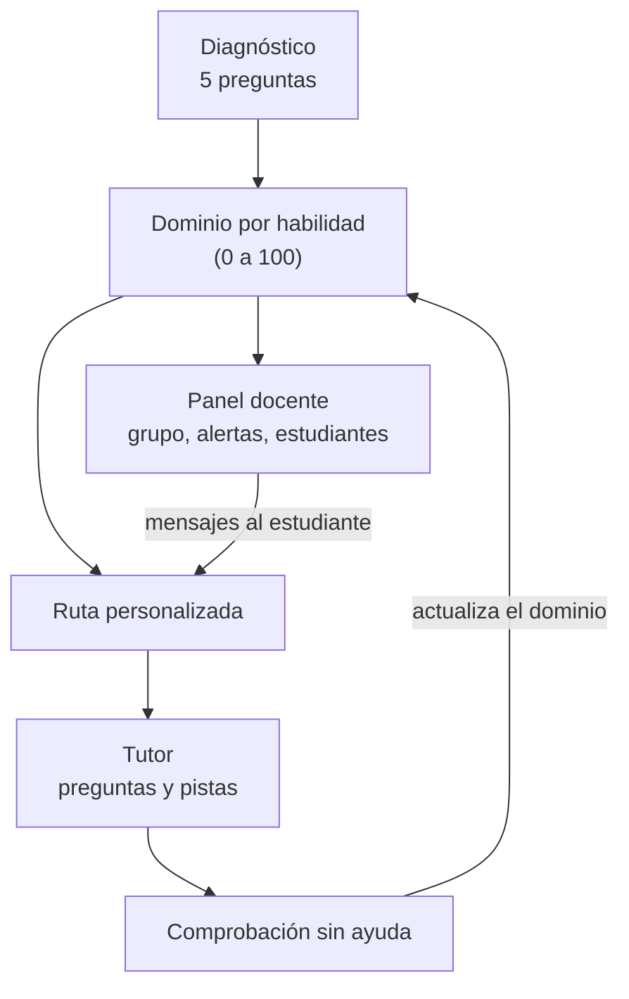

# EstudiandoAndo

Un tutor que guía con preguntas en lugar de dar la respuesta, sigue funcionando cuando se va el internet y le muestra al docente en qué se atora cada estudiante.

**Reto 5 · Aprender a la jarocha** · Hackathon Veracruz Tech Week 2026 (11 y 12 de noviembre, Instituto Tecnológico de Veracruz) · Equipo 16, **Parfaite**

> **Estado: prototipo de demostración.** Corre completo en el navegador, en un solo archivo y sin conexión. Todavía no tiene un modelo de IA conectado: el tutor responde con reglas programadas y los datos del grupo son de ejemplo. En [Solución](#solución) decimos qué funciona de verdad y qué está simulado.

## Ficha de entrega

| Campo | Contenido |
|---|---|
| **Proyecto** | EstudiandoAndo |
| **Equipo** | Equipo 16 - Parfaite : `Sergio Eduardo Mendoza Da Silveira`, `Ares Juddá Rivera Soto`,`Jose emiliano gutierrez grajales` , `Joab Emanuel Martínez Celayos`,  `Leonardo Alfredo Alejandre Sánchez` |
| **Repositorio** | `https://github.com/tuatrofisicoxav20-oss/estudiando_ando` |
| **Demo** | `https://estudiandoandohackathon.vercel.app/#/inicio`
| **Problema** | Estudiantes de Veracruz con poco tiempo y conexión intermitente resuelven la tarea pegándola en un chatbot: entregan, pero no aprenden. Su docente, con unos 120 alumnos, se entera cuando ya reprobaron. |
| **Persona usuaria** | Alejandro, 15 años, recién entró a la prepa en una localidad rural; ayuda a su papá en la parcela y estudia en ratos cortos, con apagones y mala señal. Y Juan, su maestro, con cuatro grupos de unos 30 alumnos. |
| **Solución** | Una app web para celular. El estudiante hace un diagnóstico corto, recibe una ruta según lo que le falta, practica con un tutor que solo da preguntas y pistas, y demuestra lo aprendido sin ayuda. El docente ve el avance del grupo por habilidad y recibe alertas que él revisa. El contenido va dentro de la app, así que funciona sin conexión. |
| **Impacto esperado** | Que el estudiante resuelva por su cuenta lo que antes copiaba y que el docente detecte las dificultades antes del examen. Todavía no hay piloto; proponemos medirlo con un diagnóstico al inicio y una comprobación sin ayuda al final. |

## Problema

Alejandro tiene 15 años y acaba de entrar a la prepa. Ayuda a su papá en la parcela, y en su localidad se va la luz y se cae la señal, así que estudia en ratos cortos. Para alcanzar a entregar, le pega el problema a un chatbot, copia la respuesta y la tarea queda lista. En el examen, cuando está solo, no sabe por dónde empezar.

Alejandro no es un caso aislado:

- **Los estudiantes no están entendiendo.** En PISA 2025, solo 30 % de los estudiantes mexicanos de 15 años alcanzó el nivel básico (nivel 2) en matemáticas. El promedio de la OCDE es 65 % (OCDE, 2026).
- **Ya estudian con IA.** 47 % usa chatbots para aprender al menos una vez por semana, 35 % para redactar borradores de trabajos y 34 % para resumir lo que tenía que leer (OCDE, 2026).
- **Usada como atajo, la IA perjudica.** En un experimento con cerca de mil estudiantes de bachillerato en Turquía, quienes practicaron con un chatbot sin salvaguardas sacaron 17 % menos en el examen sin ayuda que quienes nunca lo usaron. Con un tutor diseñado para dar pistas en vez de respuestas, ese efecto se mitigó en gran parte (Bastani et al., 2025).
- **En Veracruz la conexión falla.** 68.3 % de los hogares tiene internet, contra 78.3 % nacional; es el tercer estado más bajo (INEGI, 2026b). En las escuelas es peor: 25.4 % de los planteles de educación básica tiene conexión, contra 46.9 % nacional (Gobierno del Estado de Veracruz, 2025).
- **Muchos trabajan desde chicos.** En Veracruz, 292 mil niñas, niños y adolescentes de 5 a 17 años realizan trabajo infantil. Es el tercer estado con más casos (INEGI, 2026a).
- **El docente se entera tarde.** En secundaria hay 31 alumnos por docente, la relación más alta de la OCDE (Toribio, 2026). Y aun viéndolos a diario cuesta detectarlo: en un estudio con 429 estudiantes de medicina, a la sexta semana sus tutores habían identificado solo entre una cuarta y una tercera parte de quienes después reprobaron o abandonaron (O'Neill et al., 2016). Ese estudio es de universidad y de otro país, así que lo tomamos como indicio y no como medida de lo que pasa en Veracruz.

**El problema que atacamos:** el estudiante que estudia con poco tiempo y mala conexión solo tiene a la mano una herramienta que le hace la tarea, y su docente no ve a tiempo en qué se está atorando.

## Persona usuaria

| | Alejandro, estudiante | Juan, docente |
|---|---|---|
| **Quién es** | 15 años, recién ingresó a la preparatoria en una localidad rural de Veracruz | Maestro de Alejandro, con cuatro grupos al día y unos 120 estudiantes |
| **Su contexto** | Trabaja con su papá en la parcela. Hay apagones y la señal se cae. Estudia en ratos cortos, desde el celular | Con esa carga es muy difícil saber qué necesita cada estudiante |
| **Qué hace hoy** | Le pega la tarea a un chatbot y copia la respuesta | Recibe tareas completas que no le dicen qué entendió cada quien. Se entera cuando ya reprobaron |
| **Qué necesita** | Entender en poco tiempo, sin depender de la señal, y saber qué practicar | Ver a tiempo en qué proceso se complica su grupo y a quién buscar primero |
| **Qué le da EstudiandoAndo** | Preguntas y pistas en lugar de respuestas, una ruta según lo que le falta y una comprobación sin ayuda | Un mapa del grupo por habilidad, alertas que él revisa y un canal para escribirle al estudiante |

En el prototipo las cuentas de ejemplo se llaman Ximena y Diego y cursan 1.º de secundaria, porque el contenido cargado (ecuaciones lineales con una incógnita) es de ese grado. Lo elegimos como punto de partida porque es la base del álgebra que se usa en la prepa. La docente de ejemplo es la Profa. Aranda, con el grupo 1.º B.

## Solución

EstudiandoAndo tiene dos módulos que comparten la misma información.

**Estudiante.** Un diagnóstico de cinco preguntas estima cuánto domina cada habilidad del tema. Con eso se arma su ruta: primero lo que le falta. Practica con un tutor que le hace preguntas y le da hasta tres pistas, cada una más directa que la anterior, en lugar de entregarle el resultado. Para avanzar tiene que resolver ejercicios sin ayuda y explicar qué hizo.

**Docente.** Ve el avance del grupo por habilidad, quién necesita apoyo y en qué. Las alertas son sugerencias: las puede marcar como revisadas, editar o descartar. Puede escribirle a un estudiante, y ese mensaje aparece en el inicio del estudiante.

Las cinco habilidades del tema son interpretar el enunciado, operaciones inversas, despejar la incógnita, comprobar la solución y plantear problemas. Una habilidad cuenta como dominada a partir de 70 de 100, y la ruta siempre apunta a la primera que esté por debajo.

En nuestra propuesta, la IA conversacional entra cuando hay conexión, y las actividades y pistas preparadas funcionan siempre. En este prototipo solo está construido lo segundo.

### Qué funciona hoy y qué está simulado

| Parte | Funciona de verdad | Simulado o pendiente |
|---|---|---|
| **Tutor** | Reconoce cuando escribes un valor de x y lo comprueba sustituyéndolo en la ecuación. En el chat no da el resultado aunque se lo pidas. Tiene tres pistas escalonadas, y la solución completa solo se desbloquea después de la tercera | **No hay modelo de IA conectado.** Responde con reglas y frases preparadas, así que no entiende texto libre fuera de esos patrones. Revisa el resultado, no el procedimiento |
| **Diagnóstico y ruta** | Cada respuesta ajusta el dominio de su habilidad y la ruta se reordena al terminar | El dominio inicial de Ximena y Diego viene precargado |
| **Comprobación sin ayuda** | Tres ejercicios y una explicación escrita. Con tres de tres se registra el dominio y se abre la siguiente etapa | Son siempre los mismos tres ejercicios. La explicación se guarda, pero la app no la evalúa |
| **Sin conexión** | La app no hace ninguna solicitud de red. Detecta cuando se cae la conexión, deja en espera las dudas que escribas y las contesta al volver | "Sincronizar" no envía nada a ningún servidor. No es instalable: publicada en la web, no abre sin conexión si no estaba ya abierta |
| **Panel docente** | Muestra el avance real de Ximena y Diego en ese mismo navegador. Las alertas cambian de estado y los mensajes llegan al estudiante | Los demás estudiantes, los tres grupos, el texto de las alertas, los historiales y el "antes y después" son datos de ejemplo. "Generar nueva propuesta con IA" es un temporizador |
| **Contenido** | Una lección por habilidad en cuatro formatos (paso a paso, visual, ejemplo cotidiano y audio) y dos dibujos interactivos (recta numérica y balanza) | Solo Matemáticas, ecuaciones lineales con una incógnita. Las demás materias y grados aparecen como "Próximamente" |
| **Accesibilidad** | Texto ampliable, temas oscuro y de alto contraste, lectura en voz alta y uso con teclado. Cero fallos en la revisión automática con axe-core (14 pantallas, 3 temas) | Falta probar con lectores de pantalla y con personas usuarias. La lectura en voz alta depende de las voces que tenga el dispositivo |

### En qué nos distinguimos

Herramientas como Khanmigo o Gemini ya guían con preguntas, y otras como Kolibri funcionan sin conexión. No encontramos una que junte las tres cosas que buscamos: una tutoría que guía en lugar de responder, pensada para el currículo mexicano y la conexión que hay en Veracruz, y con el docente al centro, recibiendo la información de su grupo. Hoy el prototipo lo muestra con un solo tema.

## Cómo se usa

Este recorrido toma unos tres minutos y pasa por todo lo que funciona.

1. **Abre la app.** Entras como Ximena, de 1.º de secundaria. En *Tu camino para aprender*, su ruta marca "Reforzar: operaciones inversas".
2. **Habla con el tutor** (menú *Tutor*). Escribe `dime la respuesta` y no la da. Escribe `x = 4` y te hace comprobarlo: 3(4) + 5 = 17. Pide pistas con *Dame una pista*. Escribe `x = 5` y te pide explicar qué hiciste.
3. **Quita el internet.** Botón *Probar sin Wi-Fi*, o pon el dispositivo en modo avión con la app ya abierta. Las pistas y los ejercicios siguen funcionando. Si escribes una duda, queda "En espera". Con *Volver a conectar* se responde.
4. **Comprueba sin ayuda.** *Inicio → Empezar comprobación*. Son tres ejercicios sin pistas y una explicación. Con 4, 7 y −3 se registra el dominio y la ruta avanza a la siguiente habilidad.
5. **Pásate a docente** (botón *Docente*). *Grupo* muestra cómo va el 1.º B. En *Estudiantes → Ximena R.* ya aparece lo que acabas de hacer. *Apoyos* trae las alertas y *Mi clase*, la planeación.
6. **Escríbele a un estudiante.** En la alerta de Ximena, *Retroalimentar*. Regresa con el botón *Estudiante*: el mensaje está en su inicio.
7. **Mira otra dificultad.** *Más opciones → Estudiante de ejemplo → Diego*. Es el mismo tema, pero su ruta empieza en "Reforzar: interpretar el enunciado" y su tutor le plantea un problema escrito, no una ecuación.
8. **Haz el diagnóstico.** *Más opciones → Recorrido guiado → paso 3*. El recorrido te regresa a la cuenta de Ximena. Contesta las cinco preguntas y mira cómo cambia su ruta.
9. **Reinicia.** *Más opciones → Reiniciar* deja todo como al principio.

Para proyectar, *Ver pantalla → Móvil* muestra la app dentro de un marco de celular; *Más opciones* solo aparece en la vista *Adaptable*. El botón *Accesibilidad* cambia el tamaño del texto y los colores, y activa la lectura en voz alta.

## Cómo abrilo
Entrar a `https://estudiandoandohackathon.vercel.app/#/inicio`

## Tecnologías
HTML5, CSS3, JavaScript del navegador, SVG para gráficos y visualizaciones, almacenamiento local con localStorage y navegación del lado cliente mediante rutas con #. Vercel sirve los archivos estáticos; GitHub aloja el código fuente. No se utiliza framework ni API de IA en esta versión.
No usa backend, base de datos, CDN, fuentes externas ni ningún modelo de IA.

## Uso de IA (bitácora breve)
Durante la preparación del prototipo se utilizó asistencia de IA para organizar flujos, redactar lenguaje más sencillo, elaborar diagramas e interfaces y proponer ajustes de accesibilidad. La IA integrada que se ve en el prototipo utiliza respuestas simuladas y no requiere token/API externa. Las sugerencias pedagógicas deben ser revisadas y validadas por el equipo y por docentes antes de cualquier uso real.

## Qué datos usamos

### Datos públicos, para sustentar el problema

| Dato | Fuente | Dónde lo usamos |
|---|---|---|
| 30 % alcanzó al menos el nivel 2 en matemáticas (OCDE: 65 %). Muestra: 7,843 estudiantes de 297 escuelas | OCDE (2026), nota de México de PISA 2025 | App y pitch |
| 47 % usa chatbots para aprender cada semana (OCDE: 46 %); 40 % para investigar un tema, 35 % para redactar borradores y 34 % para resumir | OCDE (2026) | App y pitch |
| 17 % menos en el examen sin ayuda tras practicar con un chatbot sin salvaguardas | Bastani et al. (2025) | App |
| Hogares con internet en 2025: Veracruz 68.3 %, nacional 78.3 % | INEGI (2026b), ENDUTIH 2025 | App y pitch |
| Planteles de educación básica con internet en 2024: Veracruz 25.4 %, nacional 46.9 %. En media superior: 48.4 % y 54.1 % | Plan Veracruzano de Desarrollo 2025–2030, tabla 6.1.8, p. 74 | App |
| 292 mil niñas, niños y adolescentes en trabajo infantil en Veracruz en 2025 | INEGI (2026a), ENTI 2025 | Pitch |
| Abandono en media superior: 11.3 % en el ciclo 2023–2024 | SEP (2025) | Pitch |
| Los tutores identificaron a entre 1/4 y 1/3 de quienes después reprobaron o abandonaron | O'Neill et al. (2016) | App y pitch |
| 31 alumnos por docente en secundaria | OCDE, *Panorama de la Educación 2026*, citado por Toribio (2026) | Pitch |

Todas las cifras se cotejaron contra su fuente el 11 de noviembre de 2026. La última la leímos en la nota periodística, no en el informe de la OCDE.

### Datos dentro del prototipo

Todo lo que se ve en la demo es ficticio y se escribió para la demostración: 16 perfiles de estudiantes en tres grupos (dos de ellos, Ximena y Diego, con estado completo), cuatro alertas, historiales por semana, rachas y minutos de estudio. No usamos datos reales de ningún estudiante, docente ni escuela.

El contenido son cinco lecciones, cinco preguntas de diagnóstico, tres ejercicios de comprobación y dos problemas guiados. El tema corresponde a 1.º de secundaria (Fase 6) en los materiales de la SEP (SEP, s. f.). Se redactó para el prototipo y todavía no pasa por revisión docente.

### Datos personales

La app no pide nombre, correo ni cuenta, y no envía nada a ningún servidor. Lo que respondes se guarda solo en tu navegador (`localStorage`, clave `estudiando-ando:state-v2`) y se borra con *Reiniciar* o limpiando los datos del sitio. Una versión real con menores de edad necesitaría el consentimiento de madres, padres o tutores y un aviso de privacidad. Eso todavía no existe.

## Bitácora de IA

Usamos IA para investigar, para revisar nuestra propuesta y para documentar. Dentro del prototipo, en cambio, todavía no corre ningún modelo. Todas las entradas son del 11 de noviembre de 2026.

| Fila y hora | Herramienta | Para qué | Qué nos dio | Qué hicimos con eso |
|---|---|---|---|---|
| **1** · ≈16:00 | Claude con búsqueda web | Investigar cuánta gente estudia con IA en México y Veracruz, cómo la usa y si afecta el aprendizaje, cruzando varias fuentes | Un informe con cifras, el nivel de confianza de cada una y una lista de cifras que no conviene usar | Tomamos el 47 % de PISA y el 68.3 % de la ENDUTIH. No usamos las cifras de universitarios ni la idea de un tutor por WhatsApp |
| **2** · ≈17:30 | Claude con búsqueda web | Revisar nuestra propuesta escrita y comprobar cada cifra | Confirmó los datos, avisó que el estudio de Bastani ya estaba publicado en PNAS y marcó siete observaciones | Le pedimos releer el documento y retiró tres observaciones que el texto ya resolvía. Actualizamos la cita de Bastani y definimos una persona concreta |
| **3** · ≈17:50 | Claude con búsqueda web | Saber cuánto tarda un docente en detectar que un estudiante va mal | Que ese promedio no está medido. Lo que hay son indicios: grupos grandes y juicios docentes que fallan más con quien más batalla | Usamos el dato de 31 alumnos por docente. En la app, las alertas se presentan como sugerencias que el docente revisa, edita o descarta |
| **4** · ≈18:40 | Claude | Escribir un prompt para que un asistente de código convirtiera nuestra maqueta en una demo funcional | Un plan en seis fases: motor de reglas que revisa el procedimiento, ruta adaptativa, app instalable, panel docente, modo de presentación e IA opcional | 
| **5** · ≈23:30 | Claude con búsqueda web y un navegador de pruebas | Redactar este README | Leyó el código completo, lo ejecutó en Chromium (cero solicitudes de red, cero errores de JavaScript, cero fallos de axe-core) y cotejó cada cifra con su fuente | De ahí sale la tabla de qué funciona hoy y qué está simulado |

**Dónde se equivocó la IA y cómo lo notamos**

- No entendió la pregunta de la fila 3: pensó que hablábamos de detectar trabajos hechos con IA o fallas de seguridad. Se lo aclaramos y volvió a empezar.
- En la fila 2 marcó como fallas cosas que nuestro documento ya resolvía. Al pedirle que lo releyera renglón por renglón, las retiró.
- En esa misma revisión agregó a la propuesta cosas que no habíamos decidido, como un grupo piloto de comparación. Lo señaló ella misma y no lo adoptamos como compromiso.

## Impacto esperado

Buscamos que Alejandro deje de recibir respuestas y empiece a construirlas, y que su maestro vea a tiempo en qué proceso se complica su grupo para intervenir antes de que repruebe.

Todavía no medimos nada de esto, porque no hay piloto. Esto es lo que esperamos y cómo lo comprobaríamos:

| Lo que esperamos | Cómo lo mediríamos |
|---|---|
| El estudiante resuelve solo lo que antes copiaba | Diagnóstico al inicio y comprobación sin ayuda al final, con ejercicios distintos |
| Necesita cada vez menos ayuda | Pistas pedidas por ejercicio a lo largo de las semanas |
| El docente detecta antes | Días entre el primer error repetido y la revisión de la alerta |
| Sirve donde la señal falla | Sesiones completadas sin conexión en celulares reales |

El primer paso sería un piloto con un grupo. Si es viable, se compararía la ruta adaptativa contra una secuencia igual para todos.

## Limitaciones y lo que sigue

1. **Conectar un modelo de lenguaje** que redacte las preguntas del tutor cuando haya conexión, mientras el código sigue comprobando las cuentas.
2. **Revisar el procedimiento renglón por renglón** para saber en qué paso está el error. Hoy eso solo aparece como texto de ejemplo en las alertas.
3. **Volverla instalable**, para que abra sin conexión desde el celular.
4. **Sincronizar de verdad** el celular del estudiante con el del docente, con cuentas y consentimiento.
5. **Más ejercicios y más temas.** Hoy la comprobación repite los mismos tres ejercicios y solo hay un tema.
6. **Probarla con personas.** Está probada en Chromium de escritorio y en tamaño de celular emulado. Falta probarla en celulares reales, con estudiantes y con docentes.

## Fuentes

Consultadas el 11 de noviembre de 2026.

- Bastani, H., Bastani, O., Sungu, A., Ge, H., Kabakcı, Ö., & Mariman, R. (2025). Generative AI without guardrails can harm learning: Evidence from high school mathematics. *Proceedings of the National Academy of Sciences, 122*(26), e2422633122. https://doi.org/10.1073/pnas.2422633122
- Gobierno del Estado de Veracruz. (2025). *Plan Veracruzano de Desarrollo 2025–2030*. https://repositorio.veracruz.gob.mx/programadegobierno/wp-content/uploads/sites/4/2025/05/PVD_2025-2030.pdf
- Instituto Nacional de Estadística y Geografía. (2026a). *Encuesta Nacional de Trabajo Infantil (ENTI) 2025* (Comunicado de prensa 100/26). https://www.inegi.org.mx/contenidos/saladeprensa/boletines/2026/enti/ENTI2025_CP.pdf
- Instituto Nacional de Estadística y Geografía. (2026b). *Encuesta Nacional sobre Disponibilidad y Uso de Tecnologías de la Información en los Hogares (ENDUTIH) 2025* (Comunicado de prensa 32/26). https://www.inegi.org.mx/contenidos/saladeprensa/boletines/2026/endutih/ENDUTIH_25.pdf
- O'Neill, L. D., Mørcke, A. M., & Eika, B. (2016). The validity of student tutors' judgments in early detection of struggling in medical school. A prospective cohort study. *Advances in Health Sciences Education, 21*(5), 1061–1079. https://doi.org/10.1007/s10459-016-9677-6
- Organización para la Cooperación y el Desarrollo Económicos. (2026). *PISA 2025 results (Volume I): Mexico*. OECD Publishing. https://www.oecd.org/en/publications/pisa-2025-results-volume-i-country-notes_2d4ff9ea-en/mexico_85702d30-en.html
- Secretaría de Educación Pública. (s. f.). *Problemas de ecuaciones lineales* [Recurso de 1.º de secundaria, Fase 6]. Nueva Escuela Mexicana Digital. https://nuevaescuelamexicana.sep.gob.mx/contenido/coleccion/problemas-de-ecuaciones-lineales/
- Secretaría de Educación Pública. (2025). *Sistema Educativo de los Estados Unidos Mexicanos. Principales cifras 2024–2025*. https://www.planeacion.sep.gob.mx/Doc/estadistica_e_indicadores/principales_cifras/principales_cifras_2024_2025.pdf
- Toribio, L. (2026, 29 de septiembre). México, con la mayor carga de alumnos por docente en secundaria. *Excélsior*. https://www.excelsior.com.mx/nacional/mexico-con-mayor-carga-alumnos-por-docente-secundaria

Dentro de la app, la pantalla *Acerca del proyecto* lista además las referencias pedagógicas en las que se apoya el diseño: enseñar en el nivel adecuado, aprendizaje por dominio, andamiaje y metacognición.

## Equipo

Equipo 16 - Parfaite : `Sergio Eduardo Mendoza Da Silveira`, `Ares Juddá Rivera Soto`,`Jose emiliano gutierrez grajales` , `Joab Emanuel Martínez Celayos`,  `Leonardo Alfredo Alejandre Sánchez` 
