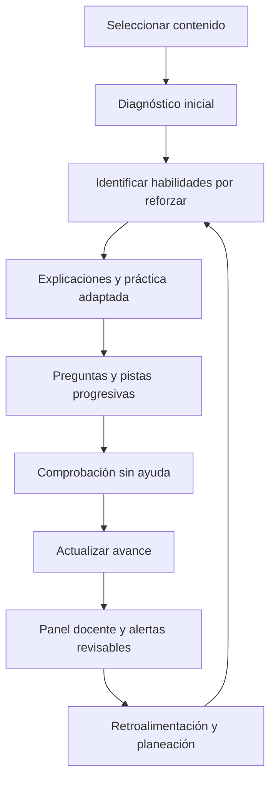
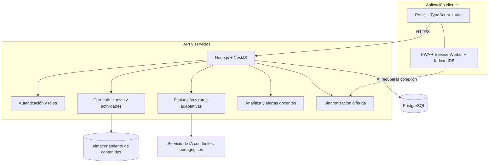

<div align="center">

# EstudiandoAndo

### Aprende a tu ritmo. Comprende de distintas maneras. Avanza con tu docente.

**Reto 5: Aprender a la jarocha · Veracruz Tech Week Hackathon 2026**  
**Equipo 16 — Parfaite**

[🌐 Abrir demostración](https://estudiandoandohackathon.vercel.app/#/inicio) · [💻 Ver repositorio](https://github.com/tuatrofisicoxav20-oss/estudiando_ando) · [📖 Cómo usarlo](#cómo-se-usa) · [🛠️ Instalación](#instalación-y-ejecución)

**Prototipo funcional · HTML, CSS y JavaScript · Sin dependencias de instalación · Datos de demostración**

</div>

> [!IMPORTANT]
> **Estado del proyecto: prototipo desarrollado para un hackathon, no producto escolar en producción.** Para priorizar una demostración integral dentro del tiempo disponible, construimos una aplicación web autónoma en **HTML5, CSS3 y JavaScript**, contenida principalmente en un único archivo. Las interfaces, ejercicios, catálogo, navegación y persistencia local son funcionales. **No hay un modelo de IA generativa conectado, cuentas institucionales, backend ni sincronización real entre dispositivos.** Al final documentamos la arquitectura profesional propuesta para implementar esas capacidades.

## Vista general

EstudiandoAndo es una propuesta de plataforma educativa **web y móvil**, diseñada para que el estudiante **aprenda en lugar de limitarse a copiar respuestas** y para que el docente **identifique dificultades de aprendizaje antes de que se conviertan en rezago**.

Nuestra solución une tres ideas: **aprendizaje adaptativo**, **acompañamiento pedagógico** y **seguimiento docente**, con una experiencia pensada para contextos de **conectividad limitada**, como diversas comunidades de Veracruz.

**Nuestra premisa:** *la tecnología debe ayudar a razonar al estudiante y ofrecer información útil al docente; no sustituir el esfuerzo de uno ni el criterio profesional del otro.*

### Vistas de la demostración

| Biblioteca de aprendizaje | Seguimiento docente |
|---|---|
| [](docs/capturas/catalogo.png) | [](docs/capturas/docente.png) |

Las capturas corresponden a la **versión HTML del prototipo**, con información académica ficticia. Puedes cambiar los modos **claro, oscuro y alto contraste** desde «Accesibilidad».

### Contenido incluido en la demostración

| Recurso | Cantidad / alcance |
|---|---|
| Materias | **8** |
| Cursos | **12** |
| Lecciones | **24** |
| Preguntas del catálogo | **72** — tres por lección |
| Formas de abordar cada lección | **5**: dibujos, ejemplos, otra explicación, paso a paso y práctica con apoyo |
| Perfiles de uso | **Estudiante** y **Docente** |
| Presentación | Web adaptable y simulador de vista móvil/escritorio |
| Accesibilidad configurable | Tema claro, oscuro, alto contraste, tamaño de texto, movimiento reducido y lectura en voz alta cuando el navegador la admite |

> El catálogo es **contenido educativo de ejemplo**, creado para demostrar distintas asignaturas y niveles. **No es un catálogo oficial de la SEP ni está conectado actualmente con planes de estudio de escuelas.** Las puntuaciones del prototipo tampoco equivalen a calificaciones académicas.

## Contenido

1. [Problema que buscamos resolver](#problema-que-buscamos-resolver)
2. [Personas usuarias](#personas-usuarias)
3. [Propuesta de solución](#propuesta-de-solución)
4. [Cómo se usa](#cómo-se-usa)
5. [Instalación y ejecución](#instalación-y-ejecución)
6. [Tecnologías del prototipo](#tecnologías-del-prototipo)
7. [Por qué se desarrolló en HTML](#por-qué-se-desarrolló-en-html)
8. [Arquitectura propuesta para producción](#arquitectura-propuesta-para-producción)
9. [Accesibilidad y diseño UX/UI](#accesibilidad-y-diseño-uxui)
10. [Uso de inteligencia artificial y bitácora](#uso-de-inteligencia-artificial-y-bitácora)
11. [Datos utilizados, fuentes y privacidad](#datos-utilizados-fuentes-y-privacidad)
12. [Validación e impacto esperado](#validación-e-impacto-esperado)
13. [Limitaciones y próximos pasos](#limitaciones-y-próximos-pasos)
14. [Equipo](#equipo)

---

## Problema que buscamos resolver

Tener acceso a recursos digitales o a un chatbot no garantiza que un estudiante comprenda los contenidos. Cuando una herramienta entrega rápidamente el resultado, puede resolver una tarea inmediata sin desarrollar el razonamiento necesario para resolver un problema nuevo por sí mismo.

A la vez, en un grupo numeroso, el docente puede recibir actividades terminadas sin conocer **qué concepto domina cada estudiante, en qué paso se equivocó y qué apoyo necesita**. Cuando las dificultades se descubren únicamente mediante un examen, muchas oportunidades de intervención ya se perdieron.

En Veracruz existe, además, una barrera concreta: la **disponibilidad desigual de internet en hogares y escuelas**. Por ello, una solución educativa debe considerar sesiones cortas, contenidos accesibles desde el celular y recursos que sigan funcionando cuando la conexión falla.

### Evidencia que sustenta el problema

| Evidencia | Dato y significado | Fuente |
|---|---|---|
| Dificultades en matemáticas | En **PISA 2025**, solo **30 %** de estudiantes mexicanos evaluados de 15 años alcanzó por lo menos el nivel 2 de competencia matemática; **70 % quedó debajo**. El promedio OCDE que alcanzó ese nivel fue **65 %**. | [OCDE, PISA 2025: México](https://www.oecd.org/en/publications/pisa-2025-results-volume-i-country-notes_2d4ff9ea-en/mexico_85702d30-en.html) |
| Uso de IA para aprender | **47 %** de estudiantes mexicanos evaluados declaró utilizar chatbots de IA para aprender al menos una vez por semana; **35 %** los usó para elaborar borradores y **34 %** para resumir textos. | [OCDE, PISA 2025: México](https://www.oecd.org/en/publications/pisa-2025-results-volume-i-country-notes_2d4ff9ea-en/mexico_85702d30-en.html) |
| Riesgo de dependencia de respuestas | En un ensayo con estudiantes de bachillerato, el grupo que practicó con un asistente generativo sin salvaguardas obtuvo un **17 % menos** en la evaluación posterior sin asistencia respecto al control. Un diseño basado en acompañamiento pedagógico mitigó ese efecto. **Este resultado pertenece al estudio citado; no es una medición de nuestra aplicación.** | [Bastani et al., 2025, PNAS](https://doi.org/10.1073/pnas.2422633122) |
| Brecha de conectividad en hogares | En 2025 tenían internet **68.3 % de los hogares de Veracruz**, frente a **78.3 % nacional**. | [INEGI, ENDUTIH 2025](https://www.inegi.org.mx/programas/endutih/2025/) |
| Conectividad escolar | En los planteles del indicador de educación básica, la conexión a internet alcanzó **25.4 % en Veracruz** frente a **46.9 % nacional** en 2024. | [Plan Veracruzano de Desarrollo 2025–2030, tabla 6.1.8](https://repositorio.veracruz.gob.mx/programadegobierno/wp-content/uploads/sites/4/2025/05/Gaceta-Num-Ext.210_PVD.pdf) |
| Dificultades no identificadas oportunamente | En una investigación de **429 estudiantes de medicina**, tras seis semanas los tutores habían identificado aproximadamente entre una cuarta y una tercera parte de quienes después reprobaron o abandonaron. **Es evidencia contextual de educación superior en otro entorno, no una estimación sobre docentes veracruzanos.** | [O'Neill et al., 2016](https://doi.org/10.1007/s10459-016-9677-6) |

**Problema central:** falta una forma accesible de acompañar el proceso de comprensión de cada estudiante, incluso con conexión limitada, y de ofrecer al docente información oportuna sobre las dificultades de su grupo sin sustituir su juicio pedagógico.

## Personas usuarias

Diseñamos dos personas para orientar las decisiones de producto. **Son perfiles ficticios construidos a partir de las necesidades estudiadas, no personas reales ni casos documentados individualmente.**

| | Alejandro — estudiante | Juan — docente |
|---|---|---|
| **Perfil** | 15 años; inicia la preparatoria en una comunidad de Veracruz | Da clases a varios grupos; ejemplo de carga: cuatro grupos de aproximadamente 30 estudiantes |
| **Contexto** | Ayuda a su familia, estudia en ratos cortos y la señal no siempre está disponible | Debe acompañar a muchos estudiantes con necesidades diferentes |
| **Frustración** | Encuentra respuestas inmediatas, pero no siempre comprende cómo llegar a ellas | Las tareas entregadas no explican qué dificultad tuvo cada persona |
| **Necesidad** | Explicaciones comprensibles, práctica adaptada, pistas y continuidad sin conexión | Detectar áreas de refuerzo, revisar avances y orientar oportunamente |
| **Respuesta de EstudiandoAndo** | Biblioteca, cinco formas de aprender, ejercicios guiados y comprobación sin ayuda | Gráficas, reportes individuales, alertas revisables, planeación y retroalimentación |

**Cuentas utilizadas en la demo:** Ximena R. y Diego M., estudiantes de ejemplo de **1.º de secundaria**, así como la Profa. Aranda y el grupo **1.º B**. Las personas usuarias del planteamiento y las cuentas ficticias del prototipo cumplen funciones distintas.

## Propuesta de solución

EstudiandoAndo propone un ciclo de aprendizaje en el que el estudiante identifica lo que sabe, recibe apoyo para comprender, practica y **demuestra sus conocimientos sin asistencia**. Los resultados permiten que el docente reconozca las necesidades del grupo y decida cómo intervenir.



### Módulo del estudiante

**1. Biblioteca por materia y nivel.** Permite explorar cursos y lecciones, filtrarlos y consultar sus objetivos. La demo incluye Matemáticas, Lengua y lectura, Ciencias, Historia, Inglés, Ciudadanía digital, Tecnología e Investigación.

**2. Diagnóstico y ruta de refuerzo.** La experiencia inicial de ecuaciones incluye un diagnóstico de cinco preguntas y un seguimiento por habilidades. En la demostración, el dominio inicial de las cuentas se precarga y los resultados de actividades pueden modificar la ruta local.

**3. Cinco formas de aprender en las 24 lecciones.** Cada contenido puede consultarse mediante:

- **Con dibujos:** diagramas, representaciones visuales y secuencias que se recorren paso a paso.
- **Con ejemplos:** casos cotidianos que conectan los conceptos con situaciones concretas.
- **Otra explicación:** reformulación del concepto, analogías y aclaración de errores comunes.
- **Paso a paso:** instrucciones ordenadas y objetivos de comprensión.
- **Practicar con apoyo:** tres preguntas por lección, pistas y revisión explicada.

Estas opciones **no asignan estilos de aprendizaje fijos**. El estudiante puede alternar libremente entre recursos hasta encontrar una explicación útil.

**4. Tutor orientado al razonamiento.** El tutor de ejemplo de ecuaciones propone preguntas, verifica ciertos valores y presenta pistas progresivas; no es un chatbot generativo libre. La idea de producción es orientar antes de revelar una solución y comprobar que el estudiante puede continuar sin ayuda.

**5. Progreso y autonomía.** El estudiante puede consultar lecciones practicadas, porcentajes de aciertos, barras por asignatura y gráficas de evolución, diferenciando el progreso de un dominio pedagógico real.

**6. Aprendizaje con conectividad limitada.** Los contenidos y las reglas locales están dentro del HTML. Una vez abierto el archivo, se puede continuar la interacción sin depender de servicios externos. La sincronización remota todavía es simulada.

### Módulo del docente

**1. Panel grupal.** Presenta indicadores y gráficas híbridas de barras y líneas, con tablas de datos alternativas, para identificar tendencias y habilidades que requieren refuerzo.

**2. Seguimiento individual.** Permite revisar el avance de las cuentas de ejemplo, su participación en lecciones y resultados registrados en el navegador.

**3. Detección y alertas para revisión.** Visualiza posibles dificultades y sugerencias de apoyo. Las alertas no son diagnósticos definitivos y el docente conserva la decisión de actuar, editarlas o descartarlas.

**4. Retroalimentación.** Permite enviar mensajes educativos simulados, visibles cuando se regresa a la cuenta correspondiente en ese mismo navegador.

**5. Planeación y biblioteca docente.** Ofrece objetivos, ejemplos, representaciones visuales, preguntas y una opción de asignar cursos al grupo de demostración. **Asignar no envía notificaciones ni genera registros institucionales reales.**

### Principios pedagógicos

El diseño se inspira en **Teaching at the Right Level (TaRL)**, **aprendizaje por dominio (Mastery Learning)**, **evaluación formativa**, **andamiaje pedagógico** y **metacognición**. En términos prácticos: partir de lo que el estudiante sabe, reforzar sus dificultades, proporcionar ayuda gradual y comprobar comprensión autónoma.

**La IA no sustituye al docente.** Una futura IA conversacional trabajaría bajo límites pedagógicos y las alertas continuarían sujetas a revisión humana.

### Qué funciona y qué no funciona aún

| Capacidad | Situación actual del HTML | Versión profesional propuesta |
|---|---|---|
| Catálogo | 8 materias, 12 cursos, 24 lecciones y 72 preguntas precargadas | Planes, niveles, instituciones y contenidos administrables |
| Cinco formas de aprendizaje | Recursos locales específicos por lección | Personalización más amplia según evidencias de comprensión |
| Ejercicios | Selección de respuestas, pistas, revisión y registro local | Banco de preguntas variable, rúbricas y evaluación del procedimiento |
| Tutor | Motor de reglas y respuestas programadas para la experiencia de ejemplo | IA generativa con límites, verificación de respuestas y supervisión |
| Ruta y diagnóstico | Flujos y métricas locales, con habilidades precargadas | Motor de adaptación validado mediante pruebas pedagógicas |
| Panel docente | Vista y registros de demostración en el mismo navegador | Usuarios, grupos, permisos y analítica persistente en servidor |
| Comunicación | Comentarios locales visibles al cambiar de perfil | Mensajería segura entre cuentas autorizadas |
| Sin internet | El HTML descargado funciona localmente; el sitio publicado debe estar cargado | PWA instalable, caché/IndexedDB y sincronización posterior |
| Datos | Ficticios, persistidos localmente cuando el navegador lo permite | Datos reales únicamente con consentimiento, seguridad y gobernanza |
| Accesibilidad | Controles y diseño orientados a buenas prácticas | Auditoría WCAG 2.2 AA, lectores de pantalla y pruebas con usuarios |

## Cómo se usa

### Acceso directo

Abre la [demostración publicada](https://estudiandoandohackathon.vercel.app/#/inicio) o descarga y abre `index.html` en un navegador moderno.

### Recorrido sugerido: estudiante

1. Entra en **Estudiante → Inicio** y revisa la ruta de aprendizaje.
2. Abre **Aprender → Biblioteca de materias**. Filtra por materia o nivel y selecciona un curso.
3. Entra a una lección y prueba las opciones **Con dibujos**, **Con ejemplos**, **Otra explicación**, **Paso a paso** y **Practicar con apoyo**. Cambiar de forma de estudio no debería borrar la selección que estés trabajando.
4. Resuelve las **tres preguntas** de la lección y pide una pista cuando la necesites. Revisa la explicación de tus respuestas y el resultado guardado.
5. Abre **Mi progreso** para consultar los avances de las materias.
6. Visita **Tutor** para probar el acompañamiento guiado de ecuaciones. También puedes hacer el **diagnóstico** y la **comprobación sin ayuda** de ese recorrido.
7. En **Estudiar sin internet**, explora los materiales y prueba la opción de simulación de desconexión.

### Recorrido sugerido: docente

1. Cambia de **Estudiante** a **Docente** usando el selector de perfil de la demo.
2. Abre **Grupo** para ver indicadores, tendencias y dificultades de la clase.
3. Ve a **Estudiantes** y consulta el progreso individual de Ximena o Diego.
4. Revisa **Apoyos / Alertas** y utiliza una recomendación para retroalimentar al estudiante.
5. Abre **Mi clase → Biblioteca** para explorar materias, preparar una clase, ver sus dibujos y preguntas o asignar un curso de ejemplo.
6. Regresa a **Estudiante** para observar el mensaje o la actividad asociada en el mismo navegador.

### Presentación para jurado

Para una demostración breve, recomendamos seguir este orden:

**Problema → Biblioteca y cinco formas de aprender → Ejercicio con pistas → Mi progreso → Panel docente → Retroalimentación → Modo sin conexión → Alcance real del prototipo.**

La aplicación también incluye un **asistente de navegación** que explica cómo llegar a una sección desde la pantalla actual y puede guiar paso a paso por los controles disponibles.

## Instalación y ejecución

### Opción A — Usar el HTML sin instalar nada

**Requisitos:** navegador moderno (Chrome, Edge o Firefox). No es necesario tener Node.js, React, Python ni instalar paquetes npm.

1. Clona el repositorio o descarga el ZIP del proyecto.
2. Localiza el archivo `index.html`.
3. Haz doble clic en `index.html` para abrirlo en tu navegador.
4. Utiliza la aplicación con los datos de demostración.

```bash
# Opcional: clonar el proyecto
git clone https://github.com/tuatrofisicoxav20-oss/estudiando_ando.git
cd estudiando_ando
```

> Si tu navegador restringe algunas funciones de `file://`, usa un servidor estático local. El estado se guarda mediante `localStorage` cuando está disponible; si se bloquea, los cambios pueden conservarse solo durante la sesión.

### Opción B — Servidor local (opcional)

Con Python instalado:

```bash
python -m http.server 5500
```

Abre **http://localhost:5500/**.

También puedes usar una extensión como **Live Server** en VS Code. **No uses `npm run dev`: esta versión HTML no tiene `package.json` ni un proceso de compilación.**

### Opción C — Publicar en Vercel

1. Asegúrate de que `index.html` esté en la **raíz** del repositorio.
2. Importa el repositorio desde Vercel.
3. Selecciona **Framework Preset: Other**.
4. Deja el **Build Command vacío** y publica el directorio raíz del proyecto.
5. Despliega y abre la URL resultante.

**Nota sobre conexión:** la app HTML no solicita contenido educativo externo durante su uso, pero **no es una PWA instalable**. Para abrir desde cero la URL publicada sin internet se requeriría un *service worker* y recursos previamente almacenados; en el navegador, el uso sin red funciona cuando el archivo ya está abierto.

### Estructura del prototipo

```text
estudiando_ando/
├── index.html      # HTML, CSS, JavaScript, contenidos y datos de ejemplo
├── vercel.json     # Configuración de despliegue estático
├── README.md       # Problema, solución, uso, tecnologías y documentación
└── docs/
    └── capturas/   # Evidencia visual de la demostración (si se incluye)
```

## Tecnologías del prototipo

| Tecnología | Uso actual |
|---|---|
| **HTML5** | Estructura semántica de páginas, formularios, botones, lecciones y diálogos |
| **CSS3** | Diseño responsivo, tarjetas, tipografía, temas, estados, contrastes y animaciones |
| **JavaScript (vanilla)** | Navegación, interacciones, ejercicios, reglas del tutor, cambios de perfil y estado |
| **SVG** | Gráficas híbridas, representaciones matemáticas, íconos y elementos visuales |
| **`localStorage`** | Persistencia local de ajustes y avances cuando el navegador lo permite |
| **Rutas con hash (`#/...`)** | Navegación del lado cliente sin configurar rutas de servidor |
| **Git / GitHub** | Control de versiones y colaboración |
| **Vercel** | Hosting y despliegue estático de la demostración |

**No se utilizan en esta versión:** React, TypeScript, Tailwind CSS, Node.js en servidor, base de datos, API externa de IA o sistema de autenticación. Tampoco hay sincronización real entre equipos.

## Por qué se desarrolló en HTML

La elección de un **archivo HTML autocontenido** fue una **decisión consciente de alcance y tiempo**, no una afirmación de que sea la arquitectura definitiva.

Durante un hackathon debíamos construir una experiencia demostrable en pocas horas: mostrar un ciclo educativo completo, representar ambos perfiles, preparar materiales accesibles y asegurar que el jurado pudiera abrir la aplicación sin instalar dependencias ni configurar servicios.

**Ventajas para el hackathon:**

- Inicio inmediato: abrir el archivo o acceder a una URL, sin `npm install`.
- Demostración estable: ejercicios, contenidos y vistas precargadas; sin depender de una API externa.
- Portabilidad: un mismo entregable puede abrirse en móvil o escritorio.
- Enfoque en validar la **solución educativa y la experiencia UX/UI**, antes que en la infraestructura.
- Menor riesgo de fallos por claves API, servidores o conexiones inestables durante la presentación.

**Límites de esta elección:** a medida que crecen las materias y usuarios, un archivo único dificulta el mantenimiento, las pruebas por módulo, la colaboración, el control de permisos y la actualización de contenidos. Por ello, **no proponemos conservar esta estructura monolítica en producción**.

## Arquitectura propuesta para producción

La siguiente arquitectura es **una propuesta técnica futura; no está implementada en el repositorio actual**. Pensamos en un despliegue evolutivo, con separación clara entre interfaz, lógica pedagógica, datos, IA y sincronización.



### Stack profesional sugerido

| Capa | Tecnologías y herramientas propuestas | Motivo |
|---|---|---|
| **Frontend** | **React + TypeScript + Vite** | Componentes reutilizables, tipado y desarrollo modular |
| **Diseño** | **Tailwind CSS**, CSS variables/tokens, componentes accesibles, Storybook | Identidad consistente, temas, documentación visual y UI escalable |
| **Gráficas y visualizaciones** | SVG, librería de gráficas accesibles según necesidad | Interacción con gráficos acompañados de tablas y texto |
| **Backend** | **Node.js + NestJS** y API REST (u otro contrato documentado) | Reglas de negocio separadas, validación, permisos y pruebas |
| **Persistencia** | **PostgreSQL + Prisma** | Datos relacionales de usuarios, cursos, intentos, grupos y mensajes |
| **Contenido y recursos** | Almacenamiento de objetos compatible con S3 + CDN | Archivos educativos versionados y entrega eficiente |
| **Sin conexión** | **PWA + Service Worker + IndexedDB** (por ejemplo, Dexie) | Lecciones disponibles sin red y registro de cambios locales |
| **Sincronización** | Cola local, API idempotente y control de versiones de registros | Reenviar avances cuando regresa la conexión, evitando duplicados |
| **IA** | API de un modelo de lenguaje detrás del servidor, reglas pedagógicas, validación y registros de evaluación | Generar orientación sin exponer claves ni delegar la evaluación matemática ciegamente |
| **Seguridad** | OAuth 2.0 / OpenID Connect, control por roles, cifrado en tránsito, auditoría | Acceso diferenciado para alumnado y docentes |
| **Calidad** | Vitest, Playwright, axe-core, Lighthouse, CI/CD con GitHub Actions | Pruebas automatizadas y accesibilidad verificable |
| **Despliegue** | Vercel para frontend; servidor/API y base de datos administrados por separado | Escalabilidad y operación independiente |

> El stack es una **recomendación de arquitectura**, no una lista de dependencias ya instaladas ni un compromiso cerrado de proveedor. Las decisiones finales dependerían de pruebas, presupuesto, seguridad, integración institucional y mantenimiento.

### Módulos de software previstos

- **Identidad y permisos:** estudiante, docente, administración y acceso a grupos autorizados.
- **Gestión curricular:** institución, grado, materias, objetivos, lecciones y recursos aprobados por docentes.
- **Motor de evaluación:** preguntas, intentos, rúbricas, pistas utilizadas y comprobaciones sin ayuda.
- **Motor adaptativo:** estimación de dominio por habilidad, prerrequisitos, refuerzos y progresión.
- **Tutor pedagógico:** conversación guiada con pistas escalonadas, ejemplos alternativos, verificación y derivación al docente cuando corresponda.
- **Analítica educativa:** progreso individual/grupal, alertas explicables y evaluación de intervenciones.
- **Sincronización offline-first:** almacenamiento local, cola de eventos, resolución de conflictos y sincronización cuando vuelva la red.

### Flujo de IA responsable en producción

La IA generativa se usaría como **interfaz de acompañamiento**, no como única fuente de verdad. Una posible secuencia sería:

1. El estudiante envía una duda dentro de una lección validada.
2. La plataforma identifica el contenido, el objetivo y los apoyos ya solicitados.
3. El servicio recupera materiales curriculares autorizados y solicita una **pregunta orientadora**, una **pista** o **un ejemplo**, no una solución automática.
4. Reglas deterministas o verificadores especializados revisan cálculos, opciones y restricciones cuando es posible.
5. Se registra el tipo de apoyo; el dominio se acredita mediante **evaluación sin asistencia**, no únicamente por completar una conversación.
6. El docente recibe **indicadores explicables**, no etiquetas irrevocables sobre una persona.

Para contenidos generados por IA se requerirían pruebas de exactitud, revisión de materiales, moderación, límites de uso, criterios de privacidad y mecanismos para corregir errores.

## Accesibilidad y diseño UX/UI

La interfaz se diseñó siguiendo principios de **claridad, consistencia, reconocimiento antes que memoria, control del usuario y prevención de errores**. Incluye navegación responsiva, retroalimentación visible, encabezados jerárquicos y un asistente contextual para encontrar tareas o secciones.

**Opciones disponibles en la demo:**

- Temas **claro**, **oscuro** y **alto contraste**; también hay identidades visuales configurables.
- Tamaño de texto y espaciado ajustables.
- Indicadores de foco y navegación mediante controles de teclado.
- Soporte para **reducir movimiento** y respeto por `prefers-reduced-motion`.
- Diagramas con texto, números y etiquetas, evitando que el color sea el único medio de información.
- Gráficas que incluyen **barras + línea de tendencia**, leyendas, valores y tablas alternativas.
- Lectura en voz alta, si el navegador y dispositivo la admiten.

**Objetivo de producción:** conformidad con **WCAG 2.2 nivel AA**, verificada con pruebas automáticas, revisión manual, lectores de pantalla y sesiones con estudiantes y docentes. **No declaramos certificación WCAG del prototipo.**

## Uso de inteligencia artificial y bitácora

Es importante distinguir entre **IA utilizada para investigar y construir la propuesta** y la **IA que operaría dentro del producto**.

**Durante el hackathon**, se utilizaron asistentes de IA como apoyo para investigación, análisis de fuentes, redacción, ideación de funcionalidades, iteraciones de interfaz y desarrollo de la demostración. El equipo debe revisar y validar estas salidas. **Dentro del prototipo actual no hay un modelo de IA generativa conectado**: el tutor y el asistente de navegación emplean reglas y contenidos preparados.

### Bitácora de IA del equipo

La siguiente bitácora conserva las actividades documentadas durante el hackathon; los horarios señalados con ≈ son aproximados según las notas del equipo.

| Fecha / momento | Herramienta | Objetivo / uso | Resultado obtenido | Decisión o validación humana |
|---|---|---|---|---|
| **11/11/2026 · ≈16:00** | Claude con búsqueda web | Explorar cifras de aprendizaje, uso de IA y conectividad en México/Veracruz | Síntesis de estadísticas y fuentes con observaciones de confiabilidad | Seleccionar indicadores rastreables a OCDE e INEGI; descartar afirmaciones no justificadas |
| **11/11/2026 · ≈17:30** | Claude con búsqueda web | Revisar el planteamiento del problema y contrastar referencias | Observaciones sobre PISA, Bastani y redacción de la propuesta | Releer y ajustar la formulación; mantener solo críticas sustentadas |
| **11/11/2026 · ≈17:50** | Claude con búsqueda web | Investigar detección docente de dificultades | Estudios indirectos sobre detección tardía; límites de extrapolación | **No** convertir un estudio universitario en una cifra de tiempo de detección en Veracruz |
| **11/11/2026 · ≈18:40** | Claude | Estructurar un plan de implementación del prototipo | Propuesta de fases para tutor, diagnóstico, panel, offline e interfaz | Priorizar el flujo demostrable durante el tiempo disponible |
| **11/11/2026 · ≈23:30** | Claude con búsqueda web y navegador de pruebas, según la bitácora original | Revisar el README y el estado de una versión previa del prototipo | Informe de revisión, fuentes y pruebas exploratorias | Documentar alcance y limitaciones; **esa revisión previa no acredita automáticamente la versión actual** |
| **Iteraciones posteriores del prototipo** | ChatGPT | Ampliar catálogo, cinco modos de aprendizaje, ayudas visuales, UX/UI, temas accesibles y documentación | Prototipo HTML ampliado y propuestas de estructura profesional | Mantener la versión HTML por facilidad de ejecución y tiempo; distinguir demos funcionales de capacidades futuras |

**Aprendizajes y correcciones del uso de IA:**

- Una consulta sobre **detección de dificultades de aprendizaje** se interpretó inicialmente como detección de trabajos hechos con IA; fue necesario reformularla.
- Algunas observaciones de revisión no correspondían al texto original y se corrigieron tras una nueva lectura.
- Se descartaron sugerencias metodológicas no acordadas por el equipo; una propuesta generada por IA no equivale a una decisión del proyecto.
- Los textos y ejercicios de demostración **no sustituyen una validación curricular y pedagógica con especialistas**.
- Los controles de accesibilidad requieren pruebas con tecnologías de asistencia y personas usuarias, más allá de una revisión de código.

**Transparencia:** no se introdujeron credenciales de un proveedor de IA en el cliente y no se entrenó un modelo con información de estudiantes. En una versión real, la IA operaría en servidor y se aplicaría una política específica de minimización, retención y protección de datos.

## Datos utilizados, fuentes y privacidad

### 1. Datos públicos para la investigación

Los datos cuantitativos del planteamiento proceden de **OCDE/PISA 2025**, **INEGI/ENDUTIH 2025**, **Plan Veracruzano de Desarrollo 2025–2030** y artículos científicos identificados en el apartado de evidencias. Se utilizan para **justificar necesidades de diseño**, no para atribuir a EstudiandoAndo resultados que todavía no ha obtenido.

Otros referentes consultados para orientar las estrategias pedagógicas incluyen:

- **Teaching at the Right Level (TaRL):** [Banerjee et al., NBER Working Paper 22746](https://doi.org/10.3386/w22746).
- **Mastery Learning:** [Education Endowment Foundation](https://educationendowmentfoundation.org.uk/education-evidence/teaching-learning-toolkit/mastery-learning/).
- **Metacognición y autorregulación:** [Education Endowment Foundation](https://educationendowmentfoundation.org.uk/education-evidence/guidance-reports/metacognition/).
- **Enseñar en el nivel adecuado en México:** [Medición Independiente de Aprendizajes (MIA)](https://www.medicionmia.org.mx/about-1).
- **Enseñanza del álgebra:** [Institute of Education Sciences, What Works Clearinghouse](https://ies.ed.gov/ncee/wwc/practiceguide/20).
- **Referencia curricular inicial:** [SEP, problemas de ecuaciones lineales (1.º de secundaria)](https://nuevaescuelamexicana.sep.gob.mx/contenido/coleccion/problemas-de-ecuaciones-lineales/).

### 2. Datos que utiliza la aplicación

| Conjunto | Origen | Uso en el prototipo |
|---|---|---|
| 8 materias, 12 cursos, 24 lecciones y 72 preguntas | **Contenido redactado para la demostración** | Biblioteca, ejercicios, pistas, dibujos y explicaciones |
| Diagnóstico de ecuaciones, habilidades iniciales y ejercicios de comprobación | Contenido y reglas locales de demostración | Ruta de refuerzo, tutor y progreso |
| Ximena, Diego, Profa. Aranda y otros perfiles/grupos ilustrativos | **Datos ficticios** | Mostrar interacción estudiante-docente, gráficas y alertas |
| Intentos, respuestas, resultados, favoritos, asignaciones y mensajes de la sesión | **Interacción local del visitante** | Actualizar las pantallas de ejemplo |
| Preferencias de apariencia y accesibilidad | Configuradas por el visitante | Personalizar el diseño y la lectura |

El prototipo puede mostrar perfiles adicionales con historiales y métricas precargadas. **No representa una base de datos de estudiantes reales.**

### 3. Almacenamiento y protección de datos

La demostración no solicita registro con nombre real, correo o contraseña. Los cambios se almacenan **en ese navegador**, mediante `localStorage` con el prefijo `estudiando-ando:`, siempre que el navegador lo permita. Si el almacenamiento no está disponible, la aplicación puede continuar con estado temporal en memoria.

**No hay backend, API de IA ni transmisión institucional de avances.** Por tanto, cambiar de equipo o abrir la página desde otro dispositivo **no sincroniza** el historial. Los datos se pueden restablecer desde los controles de la propia demo o limpiando el almacenamiento del sitio.

En producción, al tratar potencialmente con **menores de edad**, el tratamiento de datos requeriría bases jurídicas adecuadas, consentimiento cuando proceda, avisos de privacidad, permisos por rol, minimización, control de retención y revisión del marco legal mexicano aplicable. Ningún docente debería visualizar registros ajenos a sus grupos autorizados.

## Validación e impacto esperado

**No se ha realizado un piloto educativo con estudiantes reales, por lo que no afirmamos mejoras comprobadas de rendimiento, reducción de abandono ni precisión validada de alertas.** El prototipo permite demostrar una hipótesis que deberá evaluarse en condiciones reales.

| Resultado que queremos evaluar | Indicador propuesto |
|---|---|
| Mejor comprensión de contenidos | Diferencia entre diagnóstico inicial y evaluación final con ejercicios distintos, **sin IA** |
| Mayor autonomía | Disminución de pistas necesarias por habilidad, controlando la dificultad de los ejercicios |
| Detección más oportuna | Tiempo entre errores recurrentes registrados y revisión de una alerta por el docente |
| Retroalimentación útil | Mejora después de actividades recomendadas por el profesor |
| Acceso en baja conectividad | Sesiones completadas sin conexión y sincronizadas correctamente después |
| Usabilidad y accesibilidad | Éxito en tareas, tiempo por tarea, errores, pruebas con teclado y lectores de pantalla |

Un siguiente paso razonable sería un **piloto pequeño, autorizado y acompañado por docentes**, con instrumentos de evaluación previamente definidos.

## Limitaciones y próximos pasos

### Limitaciones actuales

- El **tutor** y la **guía de navegación** usan reglas y textos programados; no entienden libremente todas las preguntas.
- Aunque el catálogo incluye distintas materias y niveles, **no existe todavía un enlace automático con planes y programas oficiales por institución**.
- El sistema de ejercicios actual es finito y las explicaciones no cuentan con evaluación docente exhaustiva.
- Las alertas y el seguimiento no están validados como instrumento diagnóstico; parte de las métricas proviene de datos ficticios.
- La desconexión funciona con el documento **ya descargado o abierto**; no existe instalación PWA ni sincronización remota.
- Las vistas de estudiante y docente comparten el estado de un navegador, **no** una plataforma multiusuario.
- Las opciones de accesibilidad están implementadas como prototipo y **no equivalen a una certificación WCAG**.

### Hoja de ruta de desarrollo

**Fase 1 — Validación educativa y de usabilidad**  
Probar el prototipo con docentes y estudiantes voluntarios; revisar exactitud de lecciones y criterios de evaluación; documentar hallazgos y corregir errores.

**Fase 2 — Aplicación modular y plataforma de contenidos**  
Migrar a **React + TypeScript**; implementar API, base de datos, autenticación, roles y un sistema de contenidos curricularmente revisados.

**Fase 3 — Offline-first y sincronización**  
Incorporar **PWA, IndexedDB y sincronización diferida**, comprobando conflictos, pérdida de conexión y recuperación de sesiones reales.

**Fase 4 — IA pedagógica supervisada**  
Conectar un modelo generativo bajo límites pedagógicos, verificar respuestas, incorporar explicaciones alternativas y evaluar seguridad y calidad con revisión humana.

**Fase 5 — Piloto e impacto**  
Medir aprendizaje autónomo, uso de pistas, intervención docente, accesibilidad y desempeño en dispositivos de baja gama antes de extender la solución.

## Fuentes y bibliografía

1. **OCDE (2026).** *PISA 2025 Results (Volume I): Mexico*. [Nota de país](https://www.oecd.org/en/publications/pisa-2025-results-volume-i-country-notes_2d4ff9ea-en/mexico_85702d30-en.html).
2. **INEGI (2026).** *Encuesta Nacional sobre Disponibilidad y Uso de Tecnologías de la Información en los Hogares (ENDUTIH) 2025*. [Página de resultados](https://www.inegi.org.mx/programas/endutih/2025/).
3. **Gobierno del Estado de Veracruz (2025).** *Plan Veracruzano de Desarrollo 2025–2030*, tabla 6.1.8. [Texto oficial](https://repositorio.veracruz.gob.mx/programadegobierno/wp-content/uploads/sites/4/2025/05/Gaceta-Num-Ext.210_PVD.pdf).
4. **Bastani, H., Bastani, O., Sungu, A., Ge, H., Kabakcı, Ö. y Mariman, R. (2025).** *Generative AI without guardrails can harm learning: Evidence from high school mathematics*. *PNAS*, 122(26), e2422633122. [DOI](https://doi.org/10.1073/pnas.2422633122).
5. **O'Neill, L. D., Mørcke, A. M. y Eika, B. (2016).** *The validity of student tutors' judgments in early detection of struggling in medical school*. *Advances in Health Sciences Education*, 21, 1061–1079. [DOI](https://doi.org/10.1007/s10459-016-9677-6).
6. **Banerjee, A. et al. (2016).** *Mainstreaming an effective intervention: Evidence from randomized evaluations of Teaching at the Right Level in India*. NBER Working Paper 22746. [DOI](https://doi.org/10.3386/w22746).
7. **Education Endowment Foundation.** [Mastery Learning](https://educationendowmentfoundation.org.uk/education-evidence/teaching-learning-toolkit/mastery-learning/) y [Metacognition and Self-Regulated Learning](https://educationendowmentfoundation.org.uk/education-evidence/guidance-reports/metacognition/).
8. **Medición Independiente de Aprendizajes (MIA).** [Campamentos MIA / Enseñar en el Nivel Adecuado](https://www.medicionmia.org.mx/about-1).
9. **Institute of Education Sciences.** [Teaching Strategies for Improving Algebra Knowledge](https://ies.ed.gov/ncee/wwc/practiceguide/20).
10. **Secretaría de Educación Pública.** [Problemas de ecuaciones lineales, 1.º de secundaria](https://nuevaescuelamexicana.sep.gob.mx/contenido/coleccion/problemas-de-ecuaciones-lineales/).

**Fecha de documentación:** noviembre de 2026. Las cifras se presentan con su población, ámbito y periodo de referencia; no deben extrapolarse a todos los alumnos o escuelas sin análisis adicional.

## Equipo

**Equipo 16 — Parfaite**  
**Hackathon Veracruz Tech Week 2026 · Reto 5: Aprender a la jarocha**

- Sergio Eduardo Mendoza Da Silveira
- Ares Juddá Rivera Soto
- José Emiliano Gutiérrez Grajales
- Joab Emanuel Martínez Celayos
- Leonardo Alfredo Alejandre Sánchez

---

<div align="center">

**EstudiandoAndo: no queremos que la IA aprenda por ti. Queremos que te ayude a aprender.**

*Prototipo desarrollado como demostración tecnológica y pedagógica; no reemplaza la labor de instituciones y docentes.*

</div>
